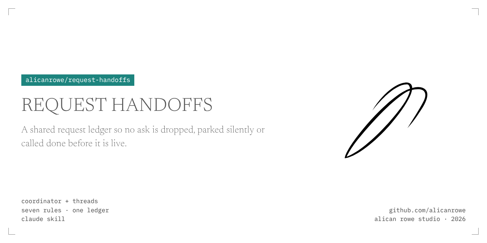

# Request handoffs skill

A Claude skill for projects where a coordinator routes a person's asks to many work threads. It keeps a shared request ledger so no ask is dropped in routing, parked behind newer work without telling the person, or denied ("nobody asked for that") without a search.

## What's in it
- **`SKILL.md`**: the seven rules (route with a row, accept or bounce, never park silently, search before you deny, do the asked thing, done means verified and live, follow through without being asked) and the worked failure that led to them.
- **`scripts/ledger.py`**: add (refused without a done-check), accept, park (refused unless the person was told), note, wait, handoff, deliver, verify (the only way to close: refused unless the live page shows the fix and the person was told), due, report, find, open and stale. Standard library only. The ledger is a JSON-lines file in the project's shared folder.

## Install
- **Claude.ai / Claude app:** zip this folder and upload it under Settings > Capabilities > Skills.
- **Claude Code:** copy the folder to `~/.claude/skills/request-handoffs/`.

## Quick start
```
export REQUEST_LEDGER=shared/request-ledger/ledger.jsonl
python3 scripts/ledger.py add --msg m123 --text "redesign the tools and handle" --owner "Case build" --deliver "project chat" --scope redesign --done-check "site page shows the new tools"
python3 scripts/ledger.py accept R001 --eta "2:00-3:30 PM ET"
python3 scripts/ledger.py park R001 --reason "shop-floor cut lists" --eta "after 5 PM ET" --told m130
python3 scripts/ledger.py find handle
python3 scripts/ledger.py deliver R001 --where m140
python3 scripts/ledger.py verify R001 --evidence "page live, new tool renders" --expect tools-v2.jpg --told m141
python3 scripts/ledger.py due
python3 scripts/ledger.py stale --hours 2
```
